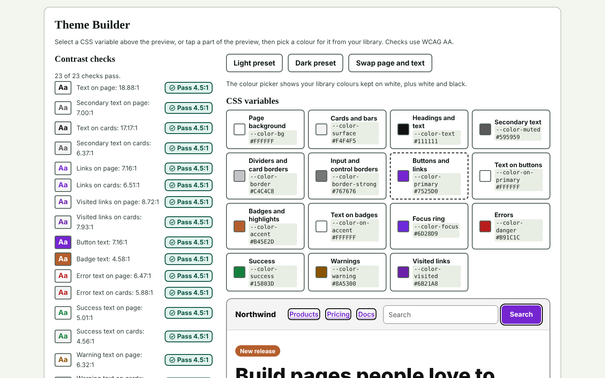
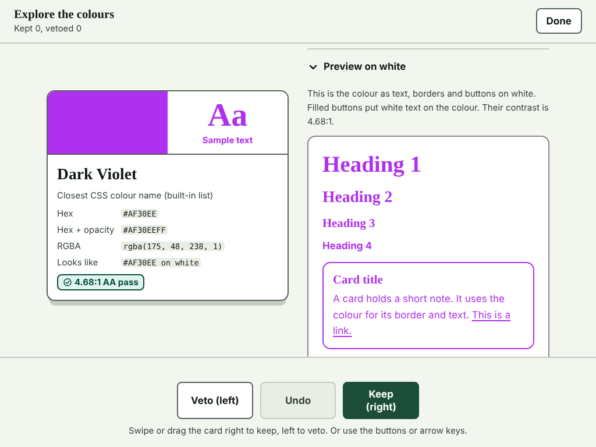
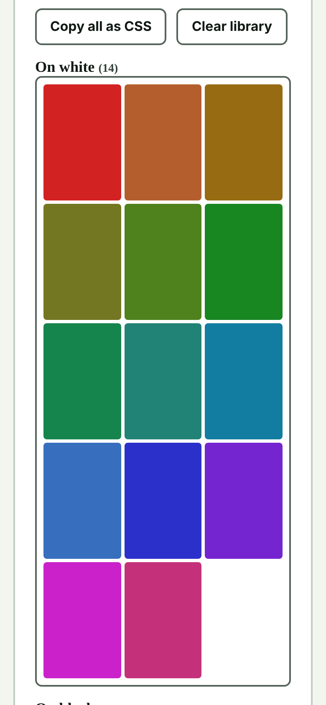

# Dathanna

Swipe to find colours that pass WCAG AA.

Dathanna deals you random colours one card at a time. Every colour passes AA text contrast (4.5:1) against white or black. Swipe right to keep a colour and left to veto it. Kept colours go into a library you can search and use to build a tested theme.

**[Open Dathanna](https://nuadyr.github.io/Dathanna/)**

## Screenshots

### Theme Builder (desktop)

### Explorer (tablet)

### Library (mobile)

## Features

- Keep or veto with a swipe, the buttons, or the arrow keys.
- Test colours against a white or a black backdrop.
- Every card shows the closest colour name, hex code, RGBA code and contrast ratio.
- Search your library by colour name or hex code, and copy it as CSS.
- Build a theme from 15 CSS variables, check contrast as you go, and copy it as CSS.
- Light, dark or automatic theme, and a button to pause motion.

## Run it

Dathanna is one HTML file with no build step and no dependencies. Open `index.html` in a browser.

## Privacy

Your library and settings stay in your browser. Colour names come from a built-in list. If you turn on "Look up colour names online", the colour's hex code and your IP address are sent to [api.color.pizza](https://api.color.pizza). It is off by default.

## Author

Dathanna is by [Nuadyr](https://nuadyr.github.io/). © 2026.
